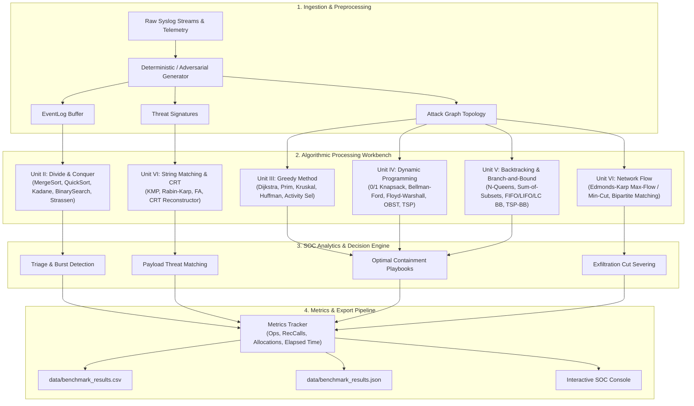

# CSEG3053 DAA PBL: Project 03 — Cybersecurity Log Threat Detection Engine
## Week 1: Engineering Requirements, Domain Invariants, & System Architecture

---

### 1. Problem Statement & Operational Context
Modern enterprise Security Operations Centers (SOCs) ingest telemetry from disparate sources (firewalls, endpoints, authentication controllers, deep packet inspection sensors) at rates exceeding hundreds of thousands of events per second. The primary operational objectives are:
1. **High-Throughput Triage:** Parse, sort, and correlate massive volumes of incoming security event logs by timestamp and anomaly severity without introducing non-linear lag.
2. **Signature & Exploit Detection:** Rapidly scan raw syslog payloads against evolving signatures of Advanced Persistent Threats (APTs) and kill-chain sequences.
3. **Resilient Containment Optimization:** Under strict Service Level Agreement (SLA) downtime constraints or capacity shocks (e.g., active ransomware propagation), select discrete containment actions that maximize risk mitigation while halting lateral network movement and data exfiltration.

This product is an algorithmic workbench and SOC analytics engine engineered in **Strict Pure C (C17 Standard)** without reliance on third-party libraries or standard library algorithmic shortcuts (`qsort`, `bsearch`, `strstr`).

---

### 2. Formal System Inputs, Outputs, & Resource Constraints

#### 2.1 Domain Data Model Inputs
* **Event Logs (`EventLog`):** Monotonically generated event stream records containing:
  * `log_id` ($\mathbb{N}$): Unique 32-bit transaction identifier.
  * `timestamp` ($\mathbb{N}$): 64-bit epoch timestamp (milliseconds).
  * `src_ip`, `dst_ip`: IPv4 strings in standard dotted-quad format (`char[16]`).
  * `severity` ($1 \le s \le 10$): Static severity classification.
  * `anomaly_delta` ($\mathbb{Z}$): Signed net deviation score per aggregation bucket for burst anomaly detection.
  * `event_code`: Categorical event token ('A'-'Z') used for kill-chain behavioral correlation.
  * `payload`: Raw string buffer (`char[256]`) containing command-line strings, HTTP requests, or syslog payloads.
* **Threat Signatures (`ThreatSignature`):** Static database of Indicators of Compromise (IoCs) containing string patterns, risk scores, and empirical trigger probabilities for Optimal BST index construction.
* **Containment Playbooks (`ContainmentAction`):** Automated response actions, each characterized by SLA disruption cost $w_i \in \mathbb{N}$ (weight/minutes), risk mitigated $v_i \in \mathbb{N}$ (value/points), and scheduling intervals $[s_i, f_i]$.
* **Enterprise Attack Topology (`AttackGraph`):** Directed network topology $G = (V, E)$ with $|V| \le 64$ hosts, adjacency weight matrix $W[u][v]$ (exploit difficulty / latency), capacity matrix $C[u][v]$ (bandwidth / throughput), and pairwise communication matrix.

#### 2.2 System Outputs
* Monotonically ordered log timelines and identified burst intervals $[t_{\text{start}}, t_{\text{end}}]$.
* Real-time pattern matches (offsets, occurrences, spurious collision counts).
* Optimal containment playbook sets under downtime budgets (exact knapsack subsets).
* Least-resistance lateral movement paths and minimum out-of-band quarantine spanning trees.
* Maximum exfiltration flows and the corresponding Minimum $s$-$t$ Cut edge list for immediate firewall severing.
* Reconstructed high-volume distributed packet counters via the Chinese Remainder Theorem.
* Empirical benchmark execution logs formatted in RFC-compliant CSV and JSON.

---

### 3. System Architecture & Component Interaction

---

### 4. Mathematical Loop Invariants

To guarantee absolute algorithmic correctness across all modules, the following formal loop invariants are maintained:

#### 4.1 Merge Sort (`merge_internal`)
* **Loop Invariant:** At the start of each iteration of the merge loop merging sub-arrays $A[low \dots mid]$ and $A[mid+1 \dots high]$ into $temp[low \dots k-1]$:
  $$\forall x \in [low, k-2], \quad temp[x] \le temp[x+1]$$
  and $temp[low \dots k-1]$ contains the $(k - low)$ smallest elements of $A[low \dots mid] \cup A[mid+1 \dots high]$ in non-decreasing order.
* **Initialization:** Before the first iteration, $k = low$, so $temp[low \dots k-1]$ is empty, vacuously true.
* **Maintenance:** At iteration $k$, the smaller of $A[i]$ and $A[j]$ is copied to $temp[k]$. Since $A[low \dots mid]$ and $A[mid+1 \dots high]$ are sorted, this selected element is greater than or equal to $temp[k-1]$ and strictly smaller than or equal to all remaining unmerged elements. Incrementing $k$ preserves the sorted invariant.
* **Termination:** When either $i > mid$ or $j > high$, the remaining sorted elements of the non-empty half are appended directly. The merged slice $temp[low \dots high]$ is sorted and is copied back into $A[low \dots high]$.

#### 4.2 Binary Search (`binary_search_iterative`)
* **Loop Invariant:** At the start of each iteration of the `while (low <= high)` loop:
  $$\text{If } target \in logs[0 \dots n-1], \quad \exists k \in [low, high] \text{ such that } logs[k].timestamp == target$$
* **Initialization:** Prior to entry, $low = 0$ and $high = n - 1$. The search window covers the entire array. If $target$ is present in $logs$, it must reside in $[0, n-1]$.
* **Maintenance:** Let $mid = \lfloor (low + high)/2 \rfloor$. Since $logs$ is sorted:
  * If $logs[mid].timestamp < target$, then $\forall x \le mid, logs[x].timestamp < target$. Thus, $target \notin logs[low \dots mid]$, and updating $low = mid + 1$ preserves the invariant.
  * If $logs[mid].timestamp > target$, then $\forall x \ge mid, logs[x].timestamp > target$. Thus, $target \notin logs[mid \dots high]$, and updating $high = mid - 1$ preserves the invariant.
* **Termination:** The loop terminates either when $logs[mid].timestamp == target$ (returning $mid$), or when $low > high$. If $low > high$, the range of potential indices is empty, proving that $target \notin logs[0 \dots n-1]$.

#### 4.3 Dijkstra's Shortest Path (`dijkstra_attack_path`)
* **Loop Invariant:** For every vertex $u$ added to the settled set $S$ (extracted from the priority queue):
  $$dist[u] = \delta(source, u)$$
  where $\delta(source, u)$ denotes the true minimum weight of any path from $source$ to $u$ in $G$.
* **Initialization:** Initially $S = \emptyset$, $dist[source] = 0$, and for all $v \ne source$, $dist[v] = \infty$. The claim holds vacuously.
* **Maintenance:** When vertex $u = \arg\min_{v \notin S} dist[v]$ is extracted, if there existed a shorter path from $source$ to $u$, it would have to leave $S$ via some boundary edge $(x, y)$ with $x \in S, y \notin S$. Since edge weights are non-negative ($w(x, y) \ge 0$), the subpath length to $y$ would be $\delta(source, x) + w(x, y) \ge dist[u]$, contradicting the minimality of $u$. Relaxing all outgoing edges $(u, v)$ preserves the triangle inequality property.
* **Termination:** Terminates when $S = V$ or when all remaining reachable vertices have been processed.

#### 4.4 Knuth-Morris-Pratt (`strmatch_kmp`)
* **Loop Invariant:** Prior to examining character $text[i]$, the state $j$ equals the length of the longest prefix of $pattern[0 \dots p-1]$ that is also a proper suffix of $text[0 \dots i-1]$:
  $$j = \max \{ k \mid pattern[0 \dots k-1] \sqsupset text[0 \dots i-1] \}$$
* **Initialization:** When $i = 0$, $j = 0$; the empty prefix matches the empty suffix.
* **Maintenance:** If $pattern[j] == text[i]$, incrementing both $i$ and $j$ extends the matched prefix by 1. If $pattern[j] \ne text[i]$ and $j > 0$, updating $j = \pi[j-1]$ shifts the pattern to the next longest prefix-suffix without backtracking $i$, maintaining the invariant.
* **Termination:** Terminates when $i = n$. Every position where $j = p$ constitutes a validated match at index $i - p$.

#### 4.5 Ford-Fulkerson / Edmonds-Karp (`ford_fulkerson_max_flow`)
* **Loop Invariant:** At the start of each augmentation round:
  1. **Capacity Constraint:** $\forall (u, v) \in V \times V, \quad 0 \le f(u, v) \le c(u, v)$.
  2. **Skew Symmetry:** $f(u, v) = -f(v, u)$.
  3. **Flow Conservation:** $\forall u \in V \setminus \{s, t\}, \quad \sum_{v \in V} f(u, v) = 0$.
* **Initialization:** $f(u, v) = 0$ everywhere. All constraints hold trivially.
* **Maintenance:** BFS finds a shortest path $p$ in residual graph $G_f$ with bottleneck capacity $c_f(p) = \min_{(u,v) \in p} c_f(u, v) > 0$. Augmenting $f$ by $c_f(p)$ preserves capacity constraints and flow conservation at every intermediate node.
* **Termination:** By the Max-Flow Min-Cut Theorem, when no $s$-$t$ path exists in $G_f$, the total net flow leaving $s$ equals the capacity of the cut $(S, T)$ where $S$ is the set of vertices reachable from $s$ in $G_f$.

---

### 5. Critical Edge Cases & Defensive Engineering
1. **Empty / Null Buffers:** Every function checks for `NULL` pointers, $n = 0$, and invalid bounds, returning standard error codes or empty result structs.
2. **Adversarial Input Resiliency:**
   * Sorted inputs against QuickSort: Handled via randomized pivot selection, preventing worst-case $O(n^2)$ recursion collapse on live log feeds.
   * Pathological repetitive payload patterns (`"AAAA...AAAB"`): Handled via KMP linear prefix automaton, preventing $O(n \times m)$ degradation seen in naive matchers.
3. **Graph Topology Anomalies:**
   * Negative-weight cycles: Detected by Bellman-Ford on the $|V|$-th relaxation pass, flagging privilege escalation loops.
   * Disconnected components: Handled gracefully by Dijkstra, Prim, and Kruskal by tagging unreachable nodes with `INF_COST`.
   * Floating-point precision: Optimal BST and Fractional Knapsack use normalized double probabilities and strict ratio ordering.
4. **Integer Overflow Prevention:**
   * Modular arithmetic in Fast Exponentiation and Rabin-Karp utilizes `uint64_t` intermediates.
   * Chinese Remainder Theorem uses GCC `__int128` intermediates for modular products to guarantee overflow-free packet counter recovery up to large integers.
